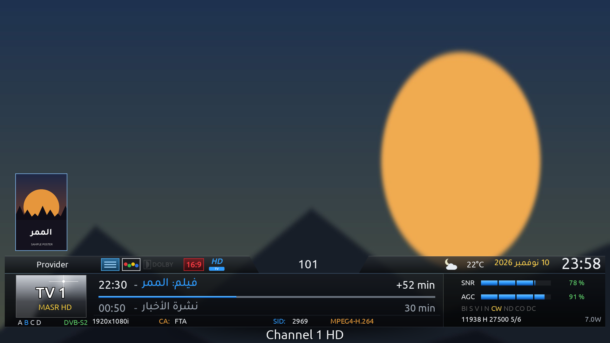

# NileGlass FHD

سكين Enigma2 لصورة **OpenBh** (Python 3.14) بدقة 1920×1080، مصمم للسرعة والثبات.



## المميزات
- إنفوبار زجاجي شفاف، ونسخة مختصرة.
- إنفوبار ثاني بشكل كارت الفيلم: بوستر، سنة، نوع، مخرج، بلد، أبطال، تقييم، خلفية عريضة، و8 بوسترات للبرامج القادمة.
- بوسترات وتفاصيل من TMDB في قائمة القنوات والدليل ومعلومات البرنامج.
- طقس (Open-Meteo بدون مفتاح) مع قائمة مدن، الافتراضية الإسكندرية.
- إعدادات: لون التمييز، الشفافية، الخط (Ubuntu/Tajawal/Almarai/Cairo/Noto Kufi)، حجم الخط، مع معاينة فورية.
- اختبار للمفتاح والإنترنت والتخزين، نسخ احتياطي واسترجاع، تحميل ليلي للبوسترات، وتحديث تلقائي من هنا.
- كل شغل الإنترنت والهارد في الخلفية؛ أي خطأ يعني بس إن البوستر ما يظهرش.

## الجديد في 2.4
- شريط صغير لتبديل الإيمو: يمين/شمال للاختيار و OK للتشغيل (من قائمة الإضافات أو زر سريع).
- معدل البت (Bitrate) في الإنفوبار، وشاشة كاملة للأقل والأعلى والمتوسط.
- أيقونات أوضح في الإنفوبار (TXT و SUB و CA) ونجوم التقييم على البوستر.
- شاشات بشكل السكين: ضبط الماتور، حالة الإيقاف والتقديم، تشغيل الإيمو، البحث عن القنوات، DiSEqC التلقائي، قوائم الكارت (CI)، معلومات القناة، اختيار المجلد، النصوص والكونسول، والمزيد.

## الجديد في 2.3
- قائمة القنوات 14 سطر في الصفحة.
- تجهيز القنوات المجاورة: بوسترات قناتين فوق وقناتين تحت بتتحمل في الخلفية فتظهر فورًا.
- وضع الرياضة الذكي: مفيش بوستر فيلم غلط وقت الماتشات، والشريط ميغطيش النتيجة.
- حماية من النت البطيء: السيرفر اللي يفشل 3 مرات يتساب 10 دقايق بدل ما يبطّأ الجهاز.
- فحص سلامة الصور قبل حفظها وعرضها (مفيش صور بايظة).
- شاشات معلومات OScam / NCam بشكل السكين.
- قنوات وإذاعات الإنترنت بعلامة IPTV، من غير SNR وAGC.

## التثبيت
من التلنت / SSH:
```sh
wget -q -O - https://raw.githubusercontent.com/Saadmelshepiny/NileGlass-FHD/main/installer.sh | /bin/sh
```
بعدها: القائمة ← الإعدادات ← واجهة المستخدم ← السكين ← NileGlass_FHD، وأعد تشغيل الواجهة.

للبوسترات: أضف مفتاح TMDB مجاني من [themoviedb.org](https://www.themoviedb.org/settings/api) في الإضافات ← NileGlass FHD.

## Install (English)
```sh
wget -q -O - https://raw.githubusercontent.com/Saadmelshepiny/NileGlass-FHD/main/installer.sh | /bin/sh
```
Then select the skin in Menu > Setup > User Interface > Skin. Add a free TMDB API key in Plugins > NileGlass FHD for posters.

## Licences
Code: GPLv2. Fonts: Ubuntu (Ubuntu Font Licence 1.0); Tajawal, Almarai, Cairo, Noto Kufi Arabic (SIL OFL 1.1, modified: Arabic isolated presentation forms added, renamed). See `src/usr/share/enigma2/NileGlass_FHD/licenses/`.
Posters and data: [TMDB](https://www.themoviedb.org) (this product uses the TMDB API but is not endorsed or certified by TMDB). Weather: [Open-Meteo](https://open-meteo.com).
